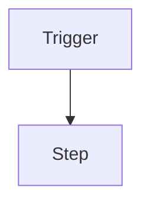

# [Process name]

**Owner:** [who's accountable]
**Status:** draft | mapped | piloting | automated
**Last updated:** [date]

## Trigger
What starts this process and where it shows up (e.g. "inquiry lands in the PM system inbox from Zillow").

## Volume and time
How often it happens, and how long it takes per occurrence today.

## Steps (current state)

| # | Step | Who | Software | Info needed (and where it lives) |
|---|---|---|---|---|
| 1 | | | | |

## Decision points
Every "if X, then Y." Include the weird cases.

- If ... then ...

## Done looks like
How you know it's finished correctly.

## What goes wrong today

## Future state

| # | Step | AUTO / AI DRAFT / HUMAN | Why |
|---|---|---|---|
| 1 | | | |

## Flow

## Open questions
